# Task 2: FastAPI + MySQL with ConfigMap, Secret & Ingress

Guestbook app (FastAPI, 2 replicas) + one MySQL server on a PV/PVC, exposed through an NGINX Ingress,
in the namespace `webapp-stack`.

## Files (apply in this order)

| File | Content |
|------|---------|
| `ingress-namespace.yaml` | Namespace `ingress-nginx` |
| `webapp-stack-namespace.yaml` | Namespace `webapp-stack` |
| `mysql-secret.yaml` | Secret `mysql-secret` (`root-password`, `app-user`, `app-password`) |
| `webapp-configmap.yaml` | ConfigMap `webapp-config` (5 keys) |
| `pv-pvc.yaml` | PV `mysql-pv` (2Gi, hostPath, `storageClassName: manual`, nodeAffinity to `minikube-m02`) + PVC `mysql-pvc` |
| `mysql-deployment.yaml` | Deployment `mysql` (1 replica, `Recreate`) |
| `mysql-service.yaml` | Service `mysql` :3306 |
| `webapp-deployment.yaml` | Deployment `webapp-api` (2 replicas) |
| `webapp-deployment.yaml` |  Service `webapp-api` 80 -> 8000 |
| `ingress.yaml` | Ingress `webapp-ingress` (class `nginx`, `/` Prefix -> `webapp-api:80`) |
| `deploy.sh` | Runs every step end to end |

## Design notes

- **Secret -> env:** `app-user` / `app-password` feed `MYSQL_USER` / `MYSQL_PASSWORD` in the app and
  `APP_DB_USER` / `APP_DB_PASSWORD` in MySQL, so both sides always agree.
- **ConfigMap -> env:** the app takes all keys through `envFrom`; MySQL takes `MYSQL_DATABASE` as `APP_DB_NAME`.
- **`MYSQL_PORT`:** kept in the ConfigMap so it overrides the `MYSQL_PORT=tcp://...` variable that Kubernetes
  injects for the Service `mysql`.
- **PV nodeAffinity:** hostPath data exists on one node only, so the PV is pinned to `minikube-m02`.
- **`Recreate` strategy:** two MySQL servers must never share the same data folder.
- **Liveness `initialDelaySeconds: 60`:** the first start creates the database and takes time.

## Run

```bash
chmod +x deploy.sh && ./deploy.sh
kubectl port-forward -n ingress-nginx svc/ingress-nginx-controller 8080:80   # second terminal
```

Open http://localhost:8080

## Verification

Add a screenshot under each check.

| # | Check | Command |
|---|-------|---------|
| 1 | Images loaded | `minikube image ls` |
| 2 | Secret / ConfigMap | `kubectl get secret mysql-secret -n webapp-stack` / `kubectl get configmap webapp-config -n webapp-stack` |
| 3 | PV / PVC bound | `kubectl get pv mysql-pv` / `kubectl get pvc mysql-pvc -n webapp-stack` |
| 4 | Deployments ready | `kubectl get deploy -n webapp-stack` |
| 5 | MySQL on m02 | `kubectl get pods -n webapp-stack -l app=mysql -o wide` |
| 6 | App env | `kubectl exec -n webapp-stack deploy/webapp-api -- env` |
| 7 | Default data | `kubectl exec -n webapp-stack deploy/mysql -- sh -c 'mysql -uroot -p"$MYSQL_ROOT_PASSWORD" -e "SELECT * FROM webapp.messages"'` |
| 8 | Ingress | `kubectl get ingress webapp-ingress -n webapp-stack` |
| 9 | App info | `curl http://localhost:8080/api/info` |
| 10 | Write | `curl -X POST http://localhost:8080/api/messages -H "Content-Type: application/json" -d '{"author":"student","content":"hello"}'` |
| 11 | Read | `curl http://localhost:8080/api/messages` |
| 12 | Persistence | `kubectl delete pod -n webapp-stack -l app=mysql`, wait, repeat check 11 |


### Screenshots

#### 1. Images loaded

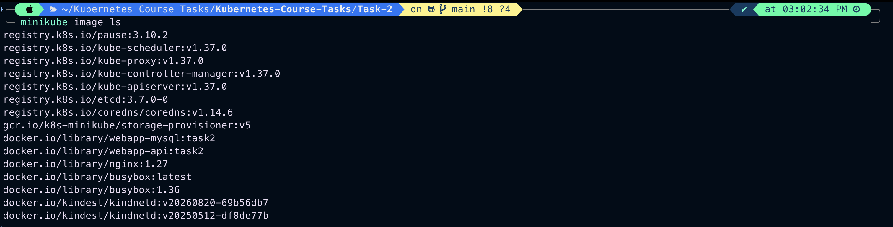

#### 2. Secret and ConfigMap

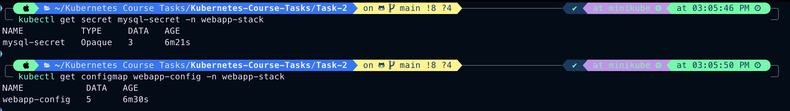

#### 3. PV and PVC bound

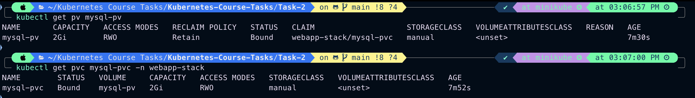

#### 4. Deployments ready

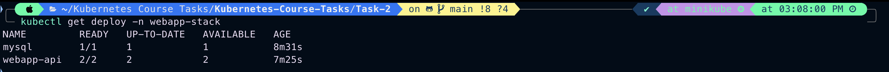

#### 5. MySQL on the PV node (minikube-m02)

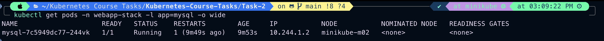

#### 6. App environment variables

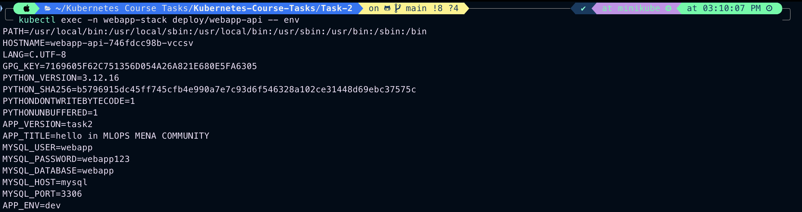

#### 7. Default data in MySQL

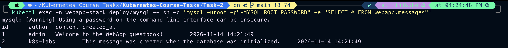

#### 8. Ingress

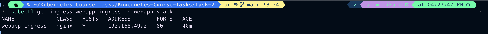

#### 9. App info (`/api/info`)

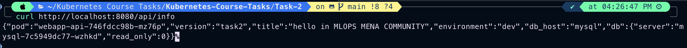

#### 10. Write a message

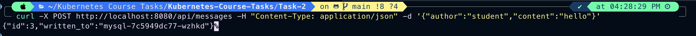

#### 11. Read messages

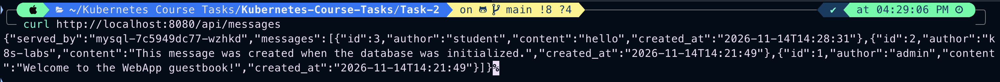

#### 12. Data survives a MySQL restart

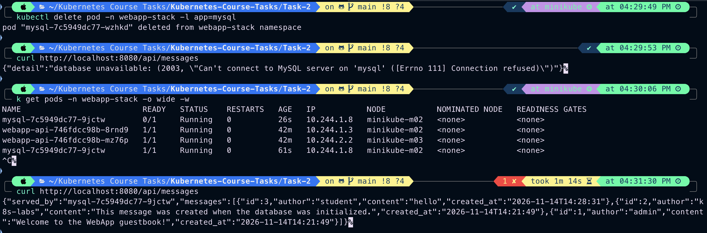

#### The web page

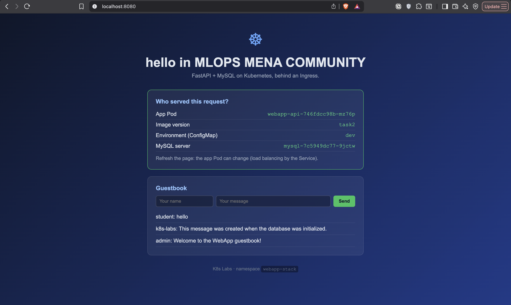

## Troubleshooting

If you change the Secret after MySQL's first start, the app gets `Access denied`. Reset the data:

```bash
kubectl delete -f 05-mysql.yaml
minikube ssh -n minikube-m02 -- sudo rm -rf /data/webapp-mysql
kubectl apply -f 05-mysql.yaml
```
